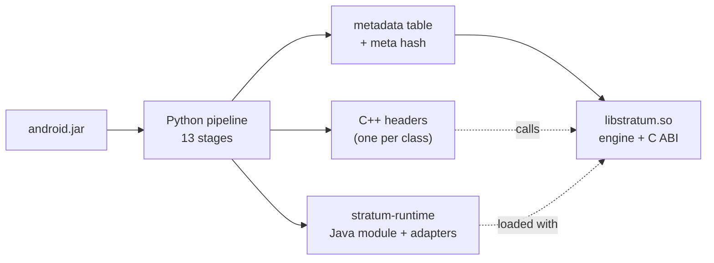
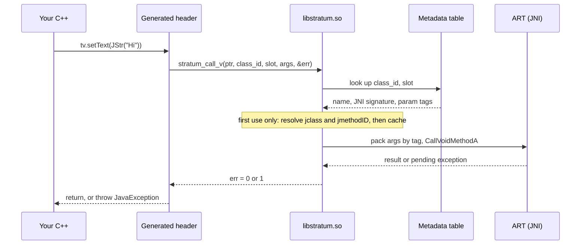
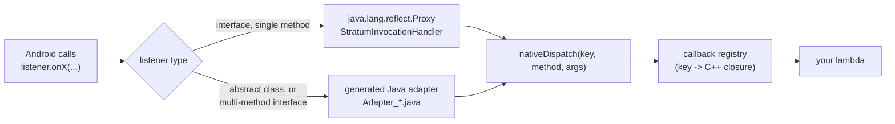
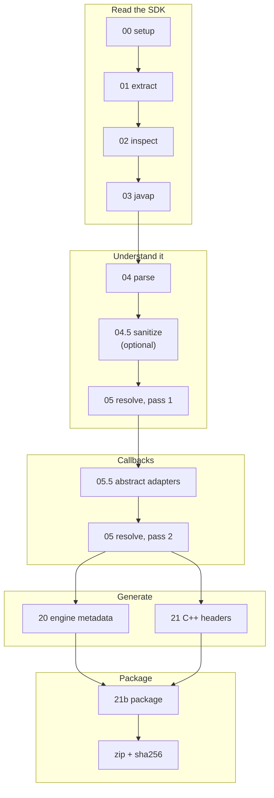

# Stratum-sys

Stratum-sys reads `android.jar` and generates what native code needs to call the Android SDK without hand-written JNI:

1. **`libstratum.so`**: a small engine with a plain C interface (`stratum_c_abi.h`). It calls any Android class by `(class_id, slot)` using a generated metadata table.
2. **A C++17 header set**: one typed wrapper class per Android class (`Button`, `TextView`, `CameraManager`, ...) that calls the C interface.
3. **`stratum-runtime`**: an Android library module with the Java side (Activity base class, callback dispatch, and generated adapter classes for abstract callbacks).

The C interface is the core of the project. The C++ headers are the first (and currently only) target built on top of it.

> **Status:** pre-1.0. One Android API level (35) is enabled by default. 

---

## Contents

- [The problem](#the-problem)
- [How it works](#how-it-works)
- [Quick start](#quick-start)
- [The pipeline, stage by stage](#the-pipeline-stage-by-stage)
- [Using the generated SDK](#using-the-generated-sdk)
- [C++ SDK notes](#c-sdk-notes)
- [Calling classes that are not in android.jar](#calling-classes-that-are-not-in-androidjar)
- [The C ABI](#the-c-abi)
- [Configuration](#configuration-pipelinejson)
- [Running stages manually](#running-stages-manually)
- [Repository layout](#repository-layout)
- [Known limitations](#known-limitations)
- [Not done yet](#not-done-yet)
- [Related projects](#related-projects)

---

## The problem

Calling the Android SDK from native code with raw JNI means, for every call:

- looking up the class and method ID, with the method's type signature written out as a string (`"(Ljava/lang/CharSequence;)V"`);
- converting arguments (for example, UTF-8 to a Java string);
- deleting local references and checking for a pending Java exception;
- for callbacks, writing and shipping a Java class that forwards into a native function.

**Pure JNI**

```cpp
void set_title(JNIEnv* env, jobject textView) {
    jclass cls = env->FindClass("android/widget/TextView");
    if (!cls) return;
    jmethodID mid = env->GetMethodID(cls, "setText", "(Ljava/lang/CharSequence;)V");
    if (!mid) { env->ExceptionClear(); env->DeleteLocalRef(cls); return; }
    jstring s = env->NewStringUTF("Hello");
    env->CallVoidMethod(textView, mid, s);
    if (env->ExceptionCheck()) { env->ExceptionDescribe(); env->ExceptionClear(); }
    env->DeleteLocalRef(s);
    env->DeleteLocalRef(cls);
}
```

**With Stratum (C++ target)**

```cpp
void set_title(TextView tv) {
    tv.setText(JStr("Hello"));
}
```

What changes: the signature string is generated from the real SDK, references are owned by C++ objects, a failed call throws `stratum::JavaException`, and callbacks can be lambdas.

What does not change: the call still crosses into the JVM through JNI. Stratum removes the boilerplate, not the boundary.

---

## How it works

An offline Python pipeline turns `android.jar` into three kinds of output. At runtime, generated headers call the engine, and the engine looks everything up in a table.



### One call at runtime



Design points that follow from the code:

- **Numbers, not names.** Stage 05 assigns every class a `class_id` and every method a `slot`, in a deterministic order. The C++ headers and the engine's table are generated from the same data, so they agree without talking to each other.
- **Precomputed argument tags.** Each method has a `param_tags` string with one character per parameter (`I`, `s`, `a`, ...). The engine switches on it; it never parses a signature at runtime.
- **Lazy resolution.** A class's `jclass` and its method and field IDs are looked up the first time the class is used.
- **Hash check.** Engine and headers each embed a hash of the pipeline input. If they differ, the app aborts at startup with a log message instead of calling the wrong slot. (Define `STRATUM_SKIP_HASH_CHECK` to disable.)

### Callbacks

Java cannot call a C++ lambda directly, so callbacks go through a Java object that forwards into the engine.



`java.lang.reflect.Proxy` can only implement interfaces, which is why stage 05.5 generates real adapter classes for abstract classes such as `CameraDevice.StateCallback` and `WebViewClient`.

---

## Quick start

**You need:** Python 3.10+, internet access for the first run, and about enough disk space for the platform zip and a JDK. The helper downloads the Android platform zip and a private JDK 17 into `build/API_<n>/`. Nothing is installed system-wide.

```bash
git clone <this repo>
cd stratum-sys
python run_pipeline_helper.py
```

When it finishes:

```
build/API_35/21_cpp_emit/output/stratum/                         <- the SDK folder
build/API_35/21_cpp_emit/release/stratum_cpp_android_api_35.zip  <- the same, zipped (+ .sha256)
```

Open `stratum/README.md` inside that folder for the step-by-step integration guide.

### Runner options

| Command | Effect |
|---|---|
| `python run_pipeline_helper.py` | Run every enabled job in `pipeline.json` |
| `--job 35` | Only that API level (job name or number, repeatable) |
| `--only 04,05` | Only stages whose id starts with these prefixes |
| `--from 04_parse` | Start at a stage and continue to the end |
| `--dry-run` | Print every command without downloading or running anything |
| `--list` | Show jobs and which stages are switched off |
| `--force-download` | Ignore cached downloads |

Downloads are resumable, retried, verified, and not repeated once verified.

---

## The pipeline, stage by stage



| Stage | Reads | Writes | What it does |
|---|---|---|---|
| **00 setup** | jar path, JDK path, API level | `setup_report.json` | Checks Python 3.10+, finds `javap`, confirms `android.jar` exists. Later stages read this report instead of taking paths again. |
| **01 extract** | `setup_report.json` | `.class` files, `extract_summary.json` | Unzips only `.class` files. Skipped if the summary already exists (use `--force`). |
| **02 inspect** | extracted classes | `available_classes.txt`, `available_by_package.txt`, `targets.json` (if missing) | Lists every class by fully qualified name. `targets.json` chooses between all classes (`"mode": "full"`) and a hand-picked list. |
| **03 javap** | classes, `targets.json` | one `.javap` file per class | Runs `javap -s -p -constants`. `-s` prints the JNI descriptors the engine needs. |
| **04 parse** | `.javap` files | one JSON per class | Parses class kind, parent, interfaces, methods, fields and constants, and maps each parameter and return type. |
| **04.5 sanitize** *(optional)* | parsed JSON | filtered JSON | Drops private members and hidden-API members flagged `blocked`. `--strict` also drops restricted, unsupported and conditional ones. Never deletes a class. |
| **05 resolve, pass 1** | JSON | JSON with ids | Assigns `class_id`, `slot`, `param_tags`, `ret_type_id`. |
| **05.5 abstract** | pass-1 JSON | `Adapter_*.java`, patched JSON | Generates Java adapters for abstract callback classes and multi-method interfaces, and marks the matching parameters. |
| **05 resolve, pass 2** | patched JSON | `output_patched/` | Re-runs the resolver so callback parameters get tag `a` instead of `p`. This output feeds stages 20 and 21. |
| **20 engine core** | `output_patched/` | `metadata_table.cpp/.h`, `meta_hash.h` | Emits the class/method/field table with one shared string pool. |
| **21 cpp emit** | `output_patched/` | headers, `API_INDEX.txt` | One header per class. Inherited methods are flattened in. |
| **21b package** | engine, headers, `runtime/` | `stratum/` folder | Assembles the SDK and renders `build.gradle` and the SDK README from templates. Stops if the two meta hashes differ. |
| **zip** | `stratum/` | `.zip`, `.zip.sha256` | Compresses the SDK. |

Stage 05 runs twice on purpose. Pass 1 gives stage 05.5 a well-formed corpus; pass 2 is the run whose output is actually used.

### Argument tags

Computed in stage 05, switched on in the engine.

| Tag | Java type | C++ type |
|---|---|---|
| `Z B C S I J F D` | primitives | `bool int8_t uint16_t int16_t int32_t int64_t float double` |
| `s` | `String`, `CharSequence` | `JStr` (UTF-8 view; `nullptr` is Java null) |
| `a` | abstract-class callback | lambda or `Handlers()` (generated adapter) |
| `p` | interface callback | lambda (dynamic proxy) |
| `[ ] q f d b c h` | `byte[] int[] long[] float[] double[] boolean[] char[] short[]` | `Arr<T>` or `std::vector` |
| `T` | `String[]` | `StrArr` |
| `A` | `Object[]` and other object arrays | `ObjArr` |
| `M` | `List`, `Collection`, `Iterable` | `ListArg` (built as `ArrayList`) |
| `N` | `Map` | `MapArg` (built as `HashMap`) |
| `L` | any other object | `Object` (a JNI global reference) |

---

## Using the generated SDK

The package has two folders that go to two places in your project:

```
stratum/
├── README.md                    full integration guide
├── cpp/                         -> merge into  app/src/main/cpp/
│   ├── CMakeLists.txt              builds your library ("myapp")
│   ├── native-lib.cpp              small demo, replace with your code
│   └── stratum/                    engine: CMakeLists.txt, src/, generated/, include/
└── stratum-runtime/             -> copy to  <project root>/stratum-runtime
    ├── build.gradle                rendered from a template
    ├── consumer-rules.pro
    └── src/main/
        ├── AndroidManifest.xml
        └── java/com/stratum/{runtime,adapters}/
```

Your project afterwards:

```
MyProject/
├── settings.gradle(.kts)        add ":stratum-runtime"
├── stratum-runtime/             copied
└── app/
    ├── build.gradle(.kts)       point CMake at cpp/, depend on :stratum-runtime
    └── src/main/
        ├── cpp/                 copied (CMakeLists.txt, native-lib.cpp, stratum/)
        └── java/.../MainActivity.java
```

**1. `settings.gradle.kts`**

```kotlin
include(":app", ":stratum-runtime")
```

**2. `app/build.gradle.kts`**

```kotlin
android {
    defaultConfig {
        ndk { abiFilters += listOf("arm64-v8a", "x86_64") }
        externalNativeBuild { cmake { cppFlags += "-std=c++17" } }
    }
    externalNativeBuild { cmake { path = file("src/main/cpp/CMakeLists.txt") } }
}
dependencies {
    implementation(project(":stratum-runtime"))
}
```

**3. `MainActivity.java`**

```java
public class MainActivity extends StratumActivity {
    @Override
    protected boolean onImportMain() {
        System.loadLibrary("myapp");   // must match add_library(myapp ...) in CMakeLists.txt
        return true;
    }
}
```

`libstratum.so` is loaded by `StratumActivity` itself. Use an AppCompat-based theme.

**4. `native-lib.cpp`**: `onCreate` is found automatically (weak symbol), with nothing to register.

```cpp
#include <stratum/stratum.hpp>
#include <stratum/android/widget/LinearLayout.hpp>
#include <stratum/android/widget/TextView.hpp>
#include <stratum/android/widget/Button.hpp>
#include <stratum/android/widget/Toast.hpp>

using stratum::Activity;
using stratum::JStr;
using stratum::android::widget::LinearLayout;
using stratum::android::widget::TextView;
using stratum::android::widget::Button;
using stratum::android::widget::Toast;

void onCreate(Activity act) {
    LinearLayout root(act);
    root.setOrientation(1);                       // VERTICAL
    root.setPadding(48, 48, 48, 48);

    TextView title(act);
    title.setText(JStr("Hello from Stratum C++"));
    title.setTextSize(22.0f);
    root.addView(title);

    Button btn(act);
    btn.setText(JStr("Tap me"));
    btn.setOnClickListener([act]() {
        Toast::makeText(act, JStr("Clicked from C++"), 0).unchecked_as<Toast>().show();
    });
    root.addView(btn);

    stratum::setContentView(act, root);
}
```

Requirements on the app: `compileSdk` at least the API level the SDK was generated for, `minSdk` at least the runtime module's `minSdk` (default 24), NDK and CMake installed in Android Studio.

Header paths mirror package names: `android.widget.Button` is `<stratum/android/widget/Button.hpp>` in namespace `stratum::android::widget`. `API_INDEX.txt` in the include folder lists every generated call.

---

## C++ SDK notes

- **A default-constructed object is a null reference.** `Paint p;` is null and calling it throws. For a Java no-argument constructor, the generated header provides `create()`:
  ```cpp
  Paint p = Paint::create();
  ```
- **Object returns are untyped (`stratum::Object`).** Cast with `.as<T>()` (checked with `IsInstanceOf`) or `.unchecked_as<T>()`:
  ```cpp
  auto cm = act.getSystemService(JStr("camera")).as<CameraManager>();
  ```
- **Strings.** Arguments take `JStr`, which converts from string literals, `std::string`, `std::string_view` and `nullptr`. The view is only valid for the duration of the call. String and `CharSequence` returns come back as `std::string`.
- **Callbacks.** A single-method listener takes a lambda. Abstract classes and multi-method interfaces take `Handlers`:
  ```cpp
  seek.setOnSeekBarChangeListener(stratum::Handlers()
      .on("onProgressChanged",    [](Object s, int32_t p, bool user) { /* ... */ })
      .on("onStartTrackingTouch", [](Object s) {})
      .on("onStopTrackingTouch",  [](Object s) {}));
  ```
  A callback's return value is passed back to Java (for example a `bool` from an `onLongClick` handler).
- **Threads.** Callbacks run on whatever thread Java calls from. Touch views from the UI thread:
  ```cpp
  stratum::run_on_ui_thread([label]() { label.setText(JStr("done")); });
  ```
- **Exceptions.** A failed Java call throws `stratum::JavaException`. If a C++ exception escapes a callback, it is turned into a Java `RuntimeException`.
- **Logging.** Compile with `-DSTRATUM_LOG_ENABLED=1` to include tracing; toggle with `stratum::set_log_enabled`.

---

## Calling classes that are not in android.jar

Generated headers only cover classes in `android.jar`. For `androidx.*`, third-party libraries, or your own Java classes, use reflection:

```cpp
#include <stratum/reflect.hpp>

// static method
int32_t status = stratum::reflect::call_static<int32_t>(
    "androidx.core.content.ContextCompat", "checkSelfPermission",
    act, std::string("android.permission.CAMERA"));

// constructor, then instance method
Object helper = stratum::reflect::new_instance("com.example.MyHelper", act, 42);
stratum::reflect::call_method<void>(helper, "doWork", std::string("payload"));
```

Reflection picks a matching overload at runtime, so it is slower and less strict than generated calls. For Java calling into C++ by name, use `stratum::register_function("name", lambda)`, which is reachable from Java as `StratumRuntimeLookup.callStratum("name", args...)`.

---

## The C ABI

Everything above reduces to the functions in `20_engine_core/include/stratum_c_abi.h`. Only these are exported; the interface uses integers, pointers and plain structs, so any language that can call C can use it. `STRATUM_ABI_VERSION` is currently `1`.

| Group | Functions (selection) |
|---|---|
| Calls | `stratum_new_instance`, `stratum_call_v / _z / _i / _j / _d / _str / _o / _arr / _list` |
| Fields | `stratum_field_get_*`, `stratum_field_set_*` |
| References | `stratum_clone_ref`, `stratum_delete_ref`, `stratum_is_instance_of`, `stratum_is_same_object` |
| Values | `stratum_new_string`, `stratum_box`, `stratum_unbox`, `stratum_new_array`, `stratum_new_object_array`, `stratum_new_list`, `stratum_new_map` |
| Callbacks | `stratum_register_callback`, `stratum_remove_callback`, `stratum_post_ui` |
| App | `stratum_get_activity`, `stratum_set_content_view`, `stratum_create_view` |
| Buffers | `stratum_get_direct_buffer_address`, `stratum_surface_to_native_window` |
| Reflection | `stratum_reflect_call` |
| Diagnostics | `stratum_last_error`, `stratum_meta_hash`, `stratum_abi_version` |

Every function with an `int32_t* err` parameter sets `*err` to `0` on success and `1` on failure. The message is available from `stratum_last_error()`.

A call needs a `class_id` and `slot`. Those numbers come from the generated metadata for a specific pipeline run, which is why the C++ headers ship together with the matching `libstratum.so`.

---

## Configuration (`pipeline.json`)

Each entry in `jobs` is one Android API level. Everything for a job lives in `build/API_<n>/`.

| Key | Meaning |
|---|---|
| `api_version`, `android_jar_url` | API level and the platform zip to download |
| `jdk.version`, `jdk.url`, `jdk.path` | JDK to download per OS/arch, or an existing unpacked JDK folder |
| `api_versions_xml` | `auto` (from the platform zip), `skip`, a URL, or a local path |
| `hiddenapi_flags` | URL, `skip`, or a local path |
| `zip_dir`, `zip_name` | Required. Where the final zip goes (`{api}`, `{api_dir}`, `{build_root}` are substituted) |
| `stages` | Set a stage to `false` to skip it (its input must already exist from an earlier run) |
| `options.sanitize_strict` | Pass `--strict` to stage 04.5 |
| `options.min_sdk` | Pass `--min-sdk` to stage 04.5 |
| `options.closure_mode` | `parents_only`, `parents_and_interfaces` or `full` (stage 05) |
| `options.abstract_mode` | `on` or `off` (stage 05.5; `off` copies files through unchanged) |
| `options.emit_prefix` | Comma-separated package prefixes to emit headers for. Empty means everything (large). `android.app.Activity` is always emitted. |
| `options.targets_file` | Class list used by stage 03 (default `02_inspect/targets.json`) |
| `options.runtime_min_sdk` | `minSdk` written into `stratum-runtime/build.gradle` (default 24) |
| `options.runtime_java_version` | Java level written into `stratum-runtime/build.gradle` (`1.8`, `11`, `17`; the shipped config uses `11`) |
| `extra_args` | Extra command-line arguments per stage id |

`compileSdk` in the generated `build.gradle` is set to the job's `api_version`.

The second job, `android-34`, is present but disabled.

---

## Running stages manually

The runner executes the same commands. For reference, for API 35 (from the repo root):

<details>
<summary>Show the commands</summary>

```bash
python 00_setup/main.py --jar-path "third_party/android-35.jar" --api-version "35" \
  --javap-path "<path to JDK>" --jdk-version "17" \
  --api-versions-xml-path "third_party/api_versions/35/api-versions.xml" \
  --hiddenapi-path "third_party/hiddenapi/35/hiddenapi-flags.csv" \
  --output "build/API_35/00_setup"

python 01_extract/main.py  --setup "build/API_35/00_setup" --output "build/API_35/01_extract"
python 02_inspect/main.py  --input "build/API_35/01_extract" --output "build/API_35/02_inspect"
python 03_javap/main.py    --input "build/API_35/01_extract" --targets "02_inspect/targets.json" \
  --setup "build/API_35/00_setup/setup_report.json" --output "build/API_35/03_javap"
python 04_parse/main.py    --input "build/API_35/03_javap" --output "build/API_35/04_parse"
python 04_5_sanitize/main.py --input "build/API_35/04_parse" --output "build/API_35/04_5_sanitize" --strict

python 05_resolve/main.py  --input "build/API_35/04_5_sanitize" --output "build/API_35/05_resolve/output"
python 05_5_abstract/main.py --input "build/API_35/05_resolve/output" \
  --output "build/API_35/05_5_abstract/output" --mode on
python 05_resolve/main.py  --input "build/API_35/05_5_abstract/output/patched" \
  --output "build/API_35/05_resolve/output_patched"

python 20_engine_core/emit.py --input "build/API_35/05_resolve/output_patched" \
  --output "build/API_35/20_engine_core/generated"
python 21_cpp_emit/main.py --input "build/API_35/05_resolve/output_patched" \
  --output "build/API_35/21_cpp_emit/output"

python 21_cpp_emit/package.py --input "build/API_35/21_cpp_emit/output" \
  --generated "build/API_35/20_engine_core/generated" \
  --adapters "build/API_35/05_5_abstract/output/java/com/stratum/adapters" \
  --output "build/API_35/21_cpp_emit/output/stratum" \
  --api-version 35 --min-sdk 24 --java-version 11
```

`04_5_sanitize` is optional; without it, point stage 05's first pass at `04_parse` instead. `--api-version` is required for `package.py`. `--emit-prefix "android.app,android.view"` on stage 21 limits which headers are generated.

</details>

---

## Repository layout

```
stratum-sys/
├── pipeline.json              job configuration
├── run_pipeline_helper.py     the runner
├── 00_setup/ ... 05_resolve/  pipeline stages (each has main.py and a README)
├── 05_5_abstract/             adapter generator (+ targets.json: seeds, avoid list)
├── 20_engine_core/            engine sources, C ABI header, emit.py (metadata table)
├── 21_cpp_emit/               C++ header generator, package.py, templates/
├── runtime/
│   ├── stratum-runtime/       Java module sources, manifest, keep rules, build.gradle.template
│   └── templates/             app CMakeLists.txt, demo native-lib.cpp, SDK_README.md
├── third_party/               optional api-versions.xml / hiddenapi-flags.csv caches
└── build/                     generated, per API level
```

---

## Known limitations

These come from reading the code, not from a test report.

- **Parameter limit.** A method with more than 32 parameters is skipped by the C++ emitter and rejected by the engine.
- **API-level differences.** If a method or class does not exist on the device, the engine logs a warning when the class is first resolved and throws a `JavaException` when the missing method is called. Generated code is based on one `android.jar`, so guard newer APIs with a runtime SDK check.
- **Hidden APIs.** With the hidden-API list loaded, stage 04.5 removes `blocked` members. Other categories are only removed with `--strict`. Without the list, only private members are removed.
- **Adapters are selective.** Stage 05.5 generates adapters for classes in its seed list plus abstract classes whose names look like callbacks (`Callback`, `Listener`, `Observer`, `Client`, `Filter`) and that have an accessible constructor. Structural classes (`View`, `Activity`, `Service`, ...) are excluded by design; the runtime module provides `StratumActivity`, `StratumView`, `StratumService` and `StratumReceiver` instead.
- **Callback lifetime.** A callback's C++ closure is released when its Java listener object is finalized by the garbage collector, not immediately when you drop it.
- **Typed object returns.** Methods that return objects return `stratum::Object`; cast with `.as<T>()`.
- **Header volume.** Emitting every class produces a very large header tree. Use `emit_prefix` to limit it.
- **Not in `android.jar`.** `androidx` and third-party classes get no generated wrapper; use reflection.
- **Per-call cost.** Each call goes through argument packing, a local reference frame and an exception check. No measurements are published.

---

## Not done yet

Intentions, not promises:

- Build and publish SDKs for more API levels (the `android-34` job exists but is disabled).
- Additional language targets on the C ABI. The ABI and the metadata table do not depend on C++, but only the C++ target exists today.
- Automated builds and release uploads.
- Distributing `stratum-runtime` as a prebuilt artifact instead of a copied folder.

---

## Related projects

- [stratum](https://github.com/a-s-l-a-h/stratum): the Python / nanobind variant of this idea, in a separate repository.
- [stratum_android_py_3_14](https://github.com/a-s-l-a-h/stratum_android_py_3_14): an Android Studio project for that Python variant.

See `LICENSE` and `THIRD-PARTY-LICENSES.md` for licensing.